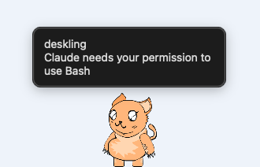

# Deskling

A desktop pet for Claude Code on macOS.

Deskling walks along the bottom of your screen and reacts to what Claude Code is doing. When Claude Code asks for permission or finishes a task, the pet tells you with a speech bubble, so you can look away from the terminal.



[한국어 설명](README.ko.md)

> Deskling is an unofficial project. It is not affiliated with or endorsed by Anthropic.

## Install

Requires macOS 13 or later.

1. Download `Deskling-x.y.z.dmg` from [Releases](https://github.com/fghjjkl32/deskling/releases/latest).
2. Open the DMG and drag **Deskling** into **Applications**.
3. Open Deskling. macOS will refuse the first time, because the app is not notarized by Apple.
4. Open **System Settings > Privacy & Security**, scroll down, and click **Open Anyway** next to the Deskling message.

If you prefer the terminal, this does the same as steps 3 and 4:

```bash
xattr -dr com.apple.quarantine /Applications/Deskling.app
```

## Connect to Claude Code

Click the paw icon in the menu bar and choose **Connect to Claude Code**.

Deskling adds its hooks to `~/.claude/settings.json` and leaves your other settings and hooks alone. A copy of the original file is saved as `settings.json.deskling-backup`. Choose **Disconnect** to remove the hooks again. Sessions that were already running pick up the hooks after you restart them.

| Claude Code | Pet |
|---|---|
| Working on your prompt | Shows the working pose |
| Asking for permission | Stops and shows a speech bubble |
| Finished | Celebrates and shows a speech bubble |
| Nothing happening | Walks around and rests |

Deskling listens on a Unix socket in `~/Library/Application Support/Deskling/`. It opens no network port and sends nothing anywhere.

## Custom skins

Choose **Skin > Open Skins Folder** from the menu, create a folder, and put your images in it:

```
skins/my-pet/
  idle.gif      resting (required)
  walk.gif      walking
  working.gif   Claude Code is working
  waiting.gif   Claude Code needs you
  done.gif      Claude Code finished
  skin.json     optional
```

- Each file can be a GIF, an animated PNG, or a still PNG (`.gif` or `.png`).
- Only `idle` is required. Missing poses use the `idle` image.
- Draw the pet facing right. Deskling flips it when it walks left.
- `skin.json` can set a display name and a height in points: `{ "name": "My Pet", "height": 120 }`.

Then pick your skin from the **Skin** menu. Only share images you have the right to share.

## Build from source

```bash
swift test
scripts/bundle.sh 0.1.0   # creates dist/Deskling.app
```

## License

Code is released under the [MIT License](LICENSE). The default pet is a CC0 cat by shuaa (megupets.com); see [CREDITS.md](CREDITS.md).
